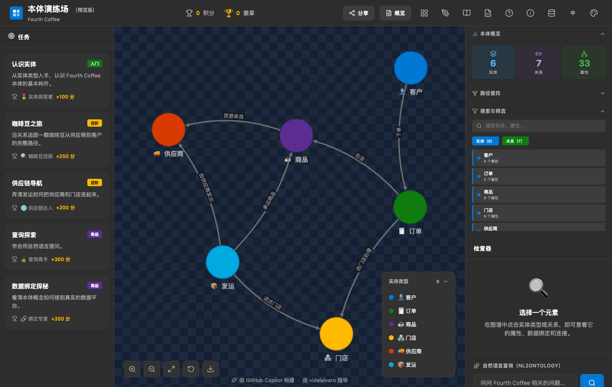

# 本体建模练习

基于微软开源的 [Ontology Playground](https://github.com/microsoft/Ontology-Playground) 汉化的本体建模工具。

**在线使用 → https://wwjay1024.github.io/ontology-playground-zh/**

[English](./README.en.md)



## 这是什么

一个纯静态的网页应用，用来学习和练习本体建模：在可视化编辑器里建立实体类型、属性和关系，实时看到图谱，导出标准的 RDF/XML，让模型与 Microsoft Fabric IQ 的语义层兼容。

零后端，打开即用。所有操作只存在浏览器本地，不上传任何数据。

## 汉化范围

| 部分 | 状态 |
|---|---|
| 界面文案 | 全部中文化，共 392 条词条，覆盖所有页面、弹窗与提示 |
| 内置示例本体 | 5 套（电商、医疗、金融制造、高校）的实体与关系全部中文化 |
| 官方教学目录 | 44 个条目的 RDF 标签与描述，以及目录元数据 |
| 本体学堂 | 74 篇课程、测验与解析 |
| 任务系统 | 5 个任务、徽章，以及按本体动态生成的步骤说明 |

界面里可以直接切换中英文，顶栏右侧的「中 / EN」按钮。

以下部分有意保留英文：

- **属性名、枚举值、实体 ID**（如 `customerId`、`Gold`）—— 它们会写入 RDF 的 IRI 和数据绑定映射，改动会破坏导出与查询。
- **外部标准本体**（Brick、FIBO、schema.org）—— 保持原样才能溯源。
- **虚构品牌与缩写**（Fourth Coffee、Zava、RDF/OWL/SHACL）。

术语以 `src/i18n/GLOSSARY.md` 为准，按本体论规范统一，例如实体类型、数据属性、定义域、值域、基数。

## 快速开始

需要 Node.js 20 以上。

```bash
npm install
npm run dev          # 本地开发，默认 http://localhost:5173
npm run build        # 生产构建，产物在 build/
npm test             # 运行测试
```

## 主要功能

- **可视化设计器** —— 建立实体、属性、关系，实时校验命名规范与标识属性，导出前检查跨实体的属性类型冲突
- **交互图谱** —— 点击节点逐层展开；大本体自动降级为语义总览，避免一次性渲染上万个节点
- **本体目录** —— 75 个预置本体，按行业、来源、许可筛选，可查看经哈希校验的原始 RDF 源
- **RDF 导入导出** —— 支持 RDF/XML，可选择「完整往返」（保留图标、颜色、绑定等扩展元数据）或「标准 OWL + SHACL」
- **本体学堂** —— 从本体基础到 FIBO、供应链的递进式课程，配小测验与图谱实操
- **任务与徽章** —— 通过实际操作图谱推进学习任务
- **嵌入组件** —— 用 `<ontology-embed>` 把交互图谱嵌进任意网页

完整的英文功能说明见 [README.en.md](./README.en.md)。

## 部署

本仓库通过 GitHub Actions 自动构建并发布到 GitHub Pages。推送到 `main` 分支即触发，约 6 分钟完成（含完整测试）。

若 Actions 不可用，可退回手动发布：

```bash
VITE_BASE_PATH=/ontology-playground-zh/ npm run build
cd build && git init -q && git checkout -q -b gh-pages \
  && git add -A && git commit -m "发布" && git push -f origin gh-pages
```

随后把仓库 Settings → Pages 的发布源切回 `gh-pages` 分支。远端的 `gh-pages` 分支常驻保留，作为 Actions 失效时的回退方案。

## 目录结构

```
src/components/     界面组件
src/data/           内置示例本体、任务、模板
src/lib/rdf/        RDF 序列化与解析
src/i18n/           中文词条与术语表
catalogue/          本体目录（RDF 源文件与元数据）
content/learn/      本体学堂课程（Markdown）
scripts/            目录编译与校验脚本
```

## 许可与来源

原项目 [microsoft/Ontology-Playground](https://github.com/microsoft/Ontology-Playground) 以 MIT 许可发布，版权归 Microsoft Corporation 所有。本仓库的汉化与改动同样以 MIT 许可发布，原版权声明完整保留在 [LICENSE](./LICENSE) 中。

## 商标说明

本项目是社区汉化版本，与 Microsoft 没有隶属或背书关系。Microsoft、Fabric 等名称为各自所有者的商标。

上游项目的英文、日文说明分别见 [README.en.md](./README.en.md) 与 [README.ja.md](./README.ja.md)，其中 `README.zh-CN.md` 为上游自带的中文版，内容早于本仓库的汉化。